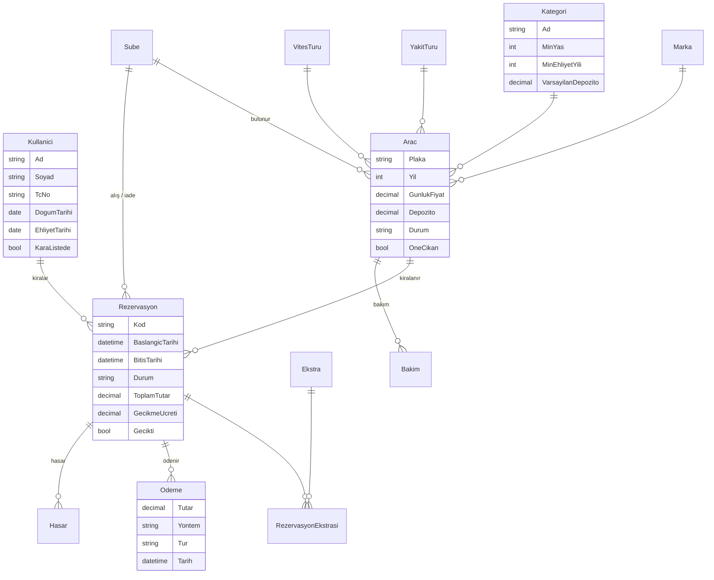

# 🚗 Rota Rent a Car — Araç Kiralama Otomasyonu

Bu proje bir **araç kiralama firmasının bilgisayar sistemidir**. İki parçadan oluşur:

1. **Müşteri sitesi**: müşterinin araç arayıp rezervasyon yaptığı web sitesi.
2. **Yönetim paneli**: personelin talepleri onayladığı, aracı teslim edip geri aldığı, ödemeleri ve raporları gördüğü bölüm. **Sitenin bütün içeriği de buradan değiştirilir**: firma adı, renkler, yazılar, sayfalar, fiyat kuralları, kategoriler, filtreler...

Her şey **C#** dilinde, **ASP.NET Core MVC** ile yazılmıştır. **Kodun tamamı Türkçedir**: sınıf, tablo, alan ve adres adları (`Arac`, `Rezervasyon`, `FiyatServisi`, `/Araclar`, `/Yonetim`) ve her dosyanın başında ne işe yaradığını anlatan açıklama var.

Bilgisayarınızda veritabanı kurmanıza **gerek yoktur**; program ilk açıldığında kendi veritabanını oluşturur ve içini örnek verilerle doldurur.

> 🌐 **Canlı adres:** **https://automarket.ardcek.com** (kısa yol: https://ardcek.com/automarket/). Admin girişi `admin@rota.com` / `Rota123!`
> Ayrıntı: [13. Canlı yayın](#13-canlı-yayın-internette-yayınlamak).

> **Bu dosyayı baştan sona sırayla okuyun.** Hiçbir şey bilmiyor olsanız bile 10 dakika içinde projeyi bilgisayarınızda çalıştırmış olacaksınız.

---

## 📑 İçindekiler

1. [En kısa yol (acelesi olanlar için)](#1-en-kısa-yol-acelesi-olanlar-için)
2. [Kurulum: adım adım](#2-kurulum-adım-adım)
3. [Programı çalıştırmak](#3-programı-çalıştırmak)
4. [Giriş bilgileri (kullanıcı adları ve şifreler)](#4-giriş-bilgileri-kullanıcı-adları-ve-şifreler)
5. [Müşteri olarak kullanım](#5-müşteri-olarak-kullanım)
6. [Yönetim paneli: günlük işler](#6-yönetim-paneli-günlük-işler)
7. [Yönetim paneli: siteyi değiştirmek](#7-yönetim-paneli-siteyi-değiştirmek)
8. [Sistemin kuralları (fiyat, iptal, gecikme...)](#8-sistemin-kuralları-fiyat-iptal-gecikme)
9. [Örnek verilerde neler var?](#9-örnek-verilerde-neler-var)
10. [API ve Swagger](#10-api-ve-swagger)
11. [Testleri çalıştırmak](#11-testleri-çalıştırmak)
12. [Veritabanını sıfırlamak](#12-veritabanını-sıfırlamak)
13. [Canlı yayın (internette yayınlamak)](#13-canlı-yayın-internette-yayınlamak)
14. [Sorun çözme (bir şey çalışmıyorsa)](#14-sorun-çözme-bir-şey-çalışmıyorsa)
15. [Kodda bir şeyi değiştirmek istiyorum: hangi dosya?](#15-kodda-bir-şeyi-değiştirmek-istiyorum-hangi-dosya)
16. [Proje nasıl çalışıyor? (teknik bilgi)](#16-proje-nasıl-çalışıyor-teknik-bilgi)
17. [Sözlük: yabancı terimler](#17-sözlük-yabancı-terimler)

Ayrıca:
- **[docs/KOD-HARITASI.md](docs/KOD-HARITASI.md)**: "Kullanıcı bir butona basınca hangi dosyalar sırayla çalışır?" Kodu ezberlemeden anlamak için yol haritası.
- **[docs/GELISTIRICI-REHBERI.md](docs/GELISTIRICI-REHBERI.md)**: "Hoca şunu eklemenizi isterse" tarifleri (yeni filtre, yeni alan, yeni ayar, yeni sayfa...).
- **[docs/SUNUM.md](docs/SUNUM.md)**: sunum akışı ve hocanın sorabileceği sorular.

---

## 1. En kısa yol (acelesi olanlar için)

Bilgisayarınızda **.NET 10 SDK** kuruluysa, proje klasöründe bir terminal açıp şunu yazın:

```bash
cd AracKiralama
dotnet run --project src/AracKiralama.Web
```

Tarayıcıda **http://localhost:5046** adresine gidin.

- Yönetim paneli için: **admin@rota.com** / şifre **Rota123!**
- Müşteri için: **musteri@rota.com** / şifre **Rota123!**

Bir şey anlamadıysanız aşağıdan devam edin. 👇

---

## 2. Kurulum: adım adım

Sadece **bir kere** yapılır.

### 2.1. .NET 10 SDK'yı kurun (zorunlu)

.NET, C# programlarını çalıştıran Microsoft yazılımıdır.

1. Şu adrese gidin: **https://dotnet.microsoft.com/download/dotnet/10.0**
2. **SDK** başlığının altından işletim sisteminize uygun olanı indirin:
   - Windows kullanıyorsanız: **Windows → x64** (Installer)
   - Mac kullanıyorsanız: **macOS → Arm64** (M1/M2/M3/M4 işlemci) veya **x64** (Intel işlemci)
3. İnen dosyayı açın ve **İleri → İleri → Yükle** diyerek kurun.
4. Kurulum bitince **açık olan bütün terminal / komut istemi pencerelerini kapatın** (yoksa yeni kurulan programı görmezler).

**Kurulduğunu kontrol edin:** Yeni bir terminal açın (aşağıda nasıl açılacağı yazıyor) ve şunu yazın:

```bash
dotnet --version
```

Ekranda `10.0.xxx` gibi bir sayı görüyorsanız tamamdır. ✅
`'dotnet' tanınmıyor` / `command not found` yazıyorsa kurulum olmamıştır veya terminali kapatıp açmamışsınızdır.

### 2.2. Terminal nasıl açılır?

- **Windows:** Başlat menüsüne `PowerShell` yazın ve açın. (Ya da proje klasörüne Dosya Gezgini'nden girip, üstteki adres çubuğuna `powershell` yazıp Enter'a basın; terminal doğrudan o klasörde açılır.)
- **Mac:** `Cmd + Boşluk` → `Terminal` yazın → Enter.

### 2.3. Proje dosyalarını edinin

**A) Dosyalar zaten bilgisayarınızdaysa** (biri size ZIP olarak verdiyse veya klasör hazırsa) bu adımı atlayın.

**B) GitHub'dan indirecekseniz**: önce [Git](https://git-scm.com/downloads) kurulu olmalı. Sonra terminalde:

```bash
git clone https://github.com/ardcek/automarket.git
cd automarket
```

İndirdiğiniz klasörün içinde iki şey var:

| Klasör / dosya | Ne? |
|---|---|
| `AracKiralama/` | **Asıl proje (C#).** Bununla çalışacağız. |
| Diğer her şey (`src/`, `prisma/`, `package.json`...) | Arkadaşımızın eski Next.js projesi. Sadece referans için duruyor, dokunmanıza gerek yok. |

### 2.4. (İsteğe bağlı) Kod düzenleyici

Kodu okumak / değiştirmek için şunlardan biri yeterlidir:

- **Visual Studio 2026** (Windows): `AracKiralama/AracKiralama.slnx` dosyasına çift tıklayın, üstteki yeşil ▶ butonuna basın.
- **Visual Studio Code** (Windows / Mac): `AracKiralama` klasörünü açın, istediğinde **C# Dev Kit** eklentisini kurun.
- **JetBrains Rider**: `AracKiralama.slnx` dosyasını açın.

Programı çalıştırmak için düzenleyici **şart değildir**; terminal yeterlidir.

---

## 3. Programı çalıştırmak

1. Terminali açın ve proje klasörüne gidin. Örneğin proje masaüstündeyse:
   ```bash
   cd Desktop/automarket/AracKiralama
   ```
   (Klasörün yerini bilmiyorsanız: Dosya Gezgini'nde `AracKiralama` klasörüne girin, adres çubuğuna `powershell` yazıp Enter.)

2. Şu komutu yazın:
   ```bash
   dotnet run --project src/AracKiralama.Web
   ```

3. **İlk çalıştırmada** biraz bekleyin (internetten paketler iner + veritabanı oluşturulur, 30 sn ile 2 dk arası sürebilir). Ekranda şuna benzer bir satır görünce hazırdır:
   ```
   Now listening on: http://localhost:5046
   ```

4. Tarayıcı kendiliğinden açılmazsa, Chrome / Edge / Firefox'a şu adresi yazın:

   ### 👉 http://localhost:5046

5. **Kapatmak için:** terminale tıklayın ve `Ctrl + C` tuşlarına basın.

> 💡 Terminal penceresi açık kaldığı sürece site çalışır. Pencereyi kapatırsanız site de kapanır.
>
> 💡 İkonlar, yazı tipi ve grafik kütüphanesi projenin içindedir (`wwwroot/lib`). İlk kurulumdan sonra **internet olmadan da** çalışır.

### Önemli adresler

| Adres | Ne açılır? |
|---|---|
| http://localhost:5046 | Müşteri sitesi (ana sayfa) |
| http://localhost:5046/Araclar | Araç listesi ve filtreler |
| http://localhost:5046/Yonetim | Yönetim paneli (önce giriş yapmak gerekir) |
| http://localhost:5046/Yonetim/Ayarlar | Sitenin ayarları (firma, renk, fiyatlar, filtreler) |
| http://localhost:5046/Hesap/Giris | Giriş sayfası |
| http://localhost:5046/swagger | API test arayüzü |

---

## 4. Giriş bilgileri (kullanıcı adları ve şifreler)

> 🔑 **Bütün hazır hesapların şifresi aynıdır: `Rota123!`** (büyük R, sonda ünlem işareti)

| Rol | E-posta (kullanıcı adı) | Şifre | Ne yapabilir? |
|---|---|---|---|
| 👑 **Admin** (yönetici) | `admin@rota.com` | `Rota123!` | **Her şey.** Yönetim panelinin tamamı + personel ekleme / rol değiştirme + demo verilerini sıfırlama. |
| 🧑‍💼 **Personel** (şube çalışanı) | `personel@rota.com` | `Rota123!` | Yönetim paneli (rezervasyon, araç, müşteri, rapor, site içeriği...). Sadece "Personel ve Roller" sayfasını göremez. |
| 🙂 **Müşteri** | `musteri@rota.com` | `Rota123!` | Araç arar, rezervasyon yapar, iptal eder, sözleşme indirir. Yönetim paneline **giremez**. |
| 🧒 **Genç müşteri** (20 yaşında) | `genc@rota.com` | `Rota123!` | Normal müşteri ama yaşı küçük olduğu için **SUV ve lüks araçları kiralayamaz**. Kuralı göstermek için var. |

Ayrıca 20 tane örnek müşteri daha var; hepsinin şifresi yine `Rota123!`. E-postaları `ad.soyad@example.com` şeklindedir, örneğin:
`mehmet.demir@example.com`, `zeynep.celik@example.com`, `ahmet.sahin@example.com`, `elif.yildiz@example.com` …
(Tam listeyi yönetim panelindeki **Müşteriler** sayfasında görebilirsiniz.)

**Giriş nasıl yapılır?**
1. Sağ üstteki **Giriş Yap** butonuna basın.
2. Giriş sayfasının altındaki **"Demo hesaplar"** kutusundan birine tıklarsanız e-posta kendiliğinden yazılır; siz sadece şifreyi (`Rota123!`) yazın.
3. **Admin veya Personel** ile girerseniz doğrudan **yönetim paneline** gidersiniz. Müşteri ile girerseniz ana sayfaya dönersiniz. (Giriş gerektiren bir sayfadan geldiyseniz girişten sonra o sayfaya dönersiniz.)

**Çıkış yapmak:** Sağ üstteki **Hesabım** → **Çıkış Yap**. (Yönetim panelinde: sol alttaki çıkış ikonu.)

**Yeni hesap açmak:** Sağ üstte **Üye Ol**. Yeni açılan her hesap **müşteri** olur. Yeni bir **personel** veya **admin** hesabını sadece admin, yönetim panelindeki **Personel ve Roller** sayfasından açabilir. (Üye kaydı **Ayarlar → Rezervasyon** sekmesinden kapatılabilir.)

**Şifremi unuttum?** Bu projede şifre sıfırlama yok. Hazır hesapların şifresi her zaman `Rota123!`'dir. Kendi açtığınız bir hesabın şifresini unuttuysanız [demo verilerini sıfırlayın](#12-veritabanını-sıfırlamak).

---

## 5. Müşteri olarak kullanım

`musteri@rota.com` ile giriş yapın (veya hiç giriş yapmadan araçlara bakabilirsiniz; rezervasyon için giriş şart).

### 5.1. Araç aramak
1. Ana sayfadaki büyük kutudan **alış şubesi**, **iade şubesi**, **alış tarihi** ve **iade tarihi**ni seçin.
2. **Araç Bul**'a basın.
3. Sadece **o tarihlerde boş olan** araçlar listelenir. Her kartta günlük fiyat ve toplam yaklaşık tutar yazar.
4. Soldaki filtrelerle daraltın:
   - **Arama kutusu** (marka veya model, örn. "clio")
   - **Kategori** (Ekonomi, Orta Sınıf, SUV, Lüks, Ticari)
   - **Marka**, **Vites**, **Yakıt**, **Koltuk sayısı**
   - **Fiyat aralığı** (en düşük / en yüksek günlük fiyat)
   - **Model yılı** (en az)
   - **Sıralama**: fiyat artan / azalan, en yeni model, en düşük km, marka-model A→Z

   Filtreyi değiştirdiğiniz anda liste yenilenir. Hangi filtrelerin görüneceğini admin **Ayarlar → Araç Listesi**'nden seçer.

### 5.2. Araç detayı ve canlı fiyat
1. Bir araçta **İncele**'ye basın.
2. Sağdaki kutuda tarihleri, şubeleri ve ek hizmetleri (Tam Kasko, Bebek Koltuğu...) değiştirin. **Fiyat dökümü anında güncellenir**: gün sayısı, indirim, ekstralar, tek yön ücreti, toplam.
3. Araç o tarihlerde doluysa sarı bir uyarı çıkar ve buton pasif olur; başka tarih deneyin.

### 5.3. Rezervasyon yapmak (3 adım)
1. Detay sayfasında **Rezervasyon Yap**.
2. **Adım 1, Tarih ve Şube:** kontrol edin, **Devam**.
3. **Adım 2, Ek Hizmetler:** istediklerinizi işaretleyin, isterseniz not yazın, **Devam**.
4. **Adım 3, Özet ve Onay:** sürücü bilgileriniz kontrol edilir (yaş ve ehliyet süresi yeterli mi?). **Kiralama koşullarını kabul ediyorum** kutusunu işaretleyin → **Talebi Gönder**.
5. Size bir **rezervasyon kodu** verilir (örn. `RZ-2026-1350`). Rezervasyonunuz **"Onay Bekliyor"** durumundadır; personel onaylayınca **"Onaylandı"** olur. (Admin **Ayarlar → Rezervasyon → Talepler otomatik onaylansın**'ı açarsa talep doğrudan onaylanır.)

> ⚠️ **Yeni üye olduysanız** önce **Hesabım → Profil ve Ehliyet** sayfasından **doğum tarihi** ve **ehliyet veriliş tarihi** girmeniz gerekir. Bu bilgiler olmadan rezervasyon yapılamaz (sistem sizi oraya yönlendirir).

### 5.4. Rezervasyonlarım
Sağ üst **Hesabım → Rezervasyonlarım**:
- **Aktif ve yaklaşan** rezervasyonlar kart olarak görünür; durum rozeti (Onay Bekliyor / Onaylandı / Kirada) yazar.
- **İptal et:** Alış saatine **24 saatten fazla** varsa ücretsizdir; daha az kaldıysa 1 günlük ücret kesilir. (Süre ayarlardan değişir.)
- **Sözleşme:** Onaylanmış rezervasyonların **PDF kiralama sözleşmesi** yeni sekmede açılır; oradan indirebilir / yazdırabilirsiniz.
- **Geçmiş:** tamamlanan, iptal edilen ve reddedilen rezervasyonlar tablo halinde.

### 5.5. Diğer
- Sağ üstteki 🌙 / ☀️ butonu **koyu / açık tema** arasında geçiş yapar.
- Menüde ve alt bilgide **Hakkımızda, İletişim, Kiralama Koşulları, KVKK** sayfaları var (hepsi yönetim panelinden düzenlenir).
- Site telefondan da düzgün görünür.

---

## 6. Yönetim paneli: günlük işler

`admin@rota.com` / `Rota123!` ile giriş yapın → kendiliğinden **http://localhost:5046/Yonetim** açılır.

Sol tarafta menü vardır (telefonda sol üstteki ☰ butonuyla açılır). Üstteki arama kutusuna **rezervasyon kodu, plaka veya müşteri adı** yazıp Enter'a basarak her yerden arama yapabilirsiniz.

### Menüdeki sayfalar

Menü üç bölümdür: **İşlemler** (günlük iş), **Tanımlar** (listeler) ve **Site İçeriği** (sitenin görünümü). Tanımlar ve Site İçeriği [7. bölümde](#7-yönetim-paneli-siteyi-değiştirmek) anlatılıyor.

| Sayfa | Ne işe yarar? |
|---|---|
| **Gösterge Paneli** | Ana ekran. Bu ayın geliri, doluluk oranı (kaç araç şu an kirada), onay bekleyen talep sayısı, bakımdaki araçlar. Aylık gelir grafiği, kategori grafiği. **Bugün teslim edilecek** ve **bugün iade alınacak** araçlar. Gecikmiş kiralama varsa en üstte **kırmızı uyarı**. |
| **Doluluk Takvimi** | Her satır bir araç, her sütun bir gün. Renkli kutular rezervasyonlardır (renk = durum). Kutunun üstüne gelince detay, tıklayınca rezervasyon açılır. Şube / kategori / gün sayısına göre filtrelenir; ‹ › ile hafta değiştirilir. |
| **Rezervasyonlar** | Tüm rezervasyonlar. Üstteki sekmelerle duruma göre süzülür (Onay Bekliyor, Onaylandı, Kirada, Gecikmiş...). Satırdaki butonlarla hızlıca **Onayla / Teslim et / İade al**. Sarı rozetteki sayı bekleyen taleplerdir. |
| **Araçlar** | Filodaki bütün araçlar. **Yeni araç** ekle, düzenle, görsel yükle, sil. Aracın detayında toplam geliri, son kiralamaları ve bakım geçmişi. |
| **Bakım** | Bakım kayıtları. Bakım tarihleri boyunca araç **kiralanamaz**. Bakım bitince **Tamamla**'ya basın. |
| **Ödemeler** | Alınan bütün ödemeler (kasa). Tarih ve yönteme (Nakit / Kredi Kartı / Havale) göre süzülür; üstte toplamlar. |
| **Müşteriler** | Bütün müşteriler, toplam harcamalarına göre sıralı. Müşteri detayında bilgileri ve geçmişi. **Kara listeye al** → o müşteri artık rezervasyon yapamaz. |
| **Raporlar** | Seçilen tarih aralığında gelir, kiralama sayısı, araç bazlı **kullanım oranı** ve şubelere göre gelir. **Excel'e aktar** butonu raporu `.xlsx` dosyası olarak indirir. |
| **Personel ve Roller** | **Sadece Admin görür.** Yeni personel/admin hesabı açma, Admin ↔ Personel rol değiştirme. |

### Bir rezervasyonun baştan sona yolculuğu

Bir rezervasyonun detay sayfasında (Rezervasyonlar → koda tıklayın) üstte o an yapılabilecek butonlar görünür:

```
 Müşteri talep gönderir
          │
          ▼
 ┌─────────────────┐   Reddet    ┌────────────┐
 │  Onay Bekliyor  │ ──────────► │ Reddedildi │
 └─────────────────┘             └────────────┘
          │ Onayla
          ▼
 ┌─────────────────┐   İptal     ┌──────────────┐
 │    Onaylandı    │ ──────────► │ İptal Edildi │
 └─────────────────┘             └──────────────┘
          │ Aracı teslim et (km + yakıt)
          ▼
 ┌─────────────────┐
 │      Kirada     │  (iade tarihi geçerse "Gecikmiş" görünür)
 └─────────────────┘
          │ İade al (km, yakıt, hasar)
          ▼
 ┌─────────────────┐
 │   Tamamlandı    │
 └─────────────────┘
```

1. **Onayla:** Araç o tarihlerde gerçekten boşsa onaylanır. Aynı araca aynı tarihlerde başka bekleyen talepler varsa **otomatik reddedilir**. *Reddet* derseniz bir sebep yazmanız istenir.
2. **Aracı teslim et:** Aracın kilometresi ve yakıt seviyesi girilir, kontrol listesi işaretlenir. Araç "Kirada" olur.
3. **İade al:** İade zamanı, kilometre, yakıt seviyesi ve varsa hasar bedeli girilir. Sistem **geç iade ücretini**, **eksik yakıt ücretini** ve hasarı **kendisi hesaplayıp** toplama ekler. Araç tekrar müsait olur ve iade edilen şubeye geçer.
4. **Ödeme al:** Sağdaki "Ödemeler" kutusundan tutar, yöntem ve tür seçip **Ödemeyi kaydet**. "Kalan" tutarı kendiliğinden düşer.
5. **Sözleşme PDF:** Her aşamada sözleşmeyi yeni sekmede açar.

### Yeni araç eklemek
1. **Araçlar → Yeni araç**.
2. Plaka (örn. `34 ABC 123`; sistem Türk plaka formatını kontrol eder), marka, model, yıl, kategori, yakıt, vites, koltuk, renk, km, şube.
3. Günlük fiyat ve depozito. (Depozitoyu boş bırakırsanız kategorinin varsayılan depozitosu kullanılır. Sürücü yaşı ve ehliyet şartları kategoriden gelir.)
4. Sağdan bir **görsel** seçin (JPG/PNG/WEBP, en fazla 3 MB) veya Görseller sayfasındaki bir adresi yapıştırın.
5. **Ana sayfada öne çıkar** işaretlenirse ana sayfadaki "öne çıkanlar" bölümünde görünür.
6. **Kaydet**. Araç müşteri sitesinde de hemen listelenir.

> Kiralama geçmişi olan araç **silinmez**, "Pasif" yapılır (raporlar bozulmasın diye). Pasif araçlar müşteri sitesinde görünmez.

---

## 7. Yönetim paneli: siteyi değiştirmek

Sitenin **neredeyse her şeyi** koda dokunmadan yönetim panelinden değişir. Kaydettiğiniz anda sitede görünür. Hepsi veritabanında saklanır; sunucu yeniden başlasa da kaybolmaz.

### 7.1. Ayarlar (`/Yonetim/Ayarlar`)

Sekmeli tek bir form:

| Sekme | Neler var? |
|---|---|
| **Genel** | Firma adı, slogan, telefon, e-posta, adres, çalışma saatleri, Instagram / X / LinkedIn adresleri. Menüde, alt bilgide, sayfa başlıklarında, PDF sözleşmede ve İletişim sayfasında kullanılır. |
| **Görünüm** | **Ana renk** ve **koyu alan rengi** (renk seçici; butonlar, linkler, ana sayfa üst bölümü bir anda değişir), köşe yuvarlaklığı, varsayılan tema (açık / koyu / cihaza göre), logo ikonu. |
| **Ana Sayfa** | Üst bölüm görseli; istatistikler, kategoriler, öne çıkan araçlar, "nasıl çalışır" ve şubeler bölümlerini **aç / kapat**; kaç öne çıkan araç gösterileceği. |
| **Fiyatlar** | Haftalık / aylık indirim günü ve oranı, farklı şubeye iade ücreti, geç iade çarpanı ve toleransı, eksik yakıt ücreti, ücretsiz iptal süresi. **Fiyat hesabında, Kiralama Koşulları sayfasında ve PDF'te anında geçerli olur.** |
| **Rezervasyon** | Yeni rezervasyon alınsın mı, talepler otomatik onaylansın mı, en uzun kiralama süresi, yeni üye kaydı açık mı. |
| **Araç Listesi** | Sayfa başına araç sayısı, varsayılan sıralama, **her filtreyi tek tek aç / kapat** (arama, kategori, marka, vites, yakıt, koltuk, fiyat aralığı, model yılı), sıralama kutusunu göster / gizle. |

> Oranlar ondalık sayı olarak yazılır: `0.10` = %10, `0.15` = %15.

En altta iki düğme var:
- **Ayarları varsayılana döndür**: bütün ayarlar ilk haline döner.
- **Demo verilerini sıfırla** (sadece Admin): araçlar, kullanıcılar ve rezervasyonlar silinip örnek veriler baştan yüklenir. Ayarlar, metinler ve sayfalar **korunur**. Sunumdan önce "bugün teslim / gecikmiş" örneklerini tazelemek için kullanın. (Sonrasında tekrar giriş yapmanız istenir.)

### 7.2. Site Metinleri (`/Yonetim/Metinler`)

Sitedeki başlıklar, buton yazıları, bölüm açıklamaları (menüdeki "Araçlar" yazısı, ana sayfa başlığı, "Araç Bul" butonu...). Kutu **boş** bırakılırsa varsayılan yazı (gri görünen) kullanılır. Değiştirilen metnin yanında "değiştirildi" rozeti çıkar.

### 7.3. Sayfalar (`/Yonetim/Sayfalar`)

Hakkımızda, İletişim, Kiralama Koşulları, KVKK ve sizin ekleyeceğiniz yeni sayfalar. Her sayfanın başlığı, adresi (`/Sayfa/kvkk` gibi), içeriği, menüde / alt bilgide görünüp görünmeyeceği ve sırası ayarlanır.

İçerik düz metindir, HTML bilmeniz gerekmez:

| Yazdığınız | Sitede |
|---|---|
| Boş satır | Yeni paragraf |
| `- Madde` | Madde işaretli liste |
| `## Başlık` | Ara başlık |
| `{firma}`, `{telefon}`, `{eposta}` | Ayarlardaki firma bilgisi |
| `{haftalik-indirim}`, `{tek-yon}`, `{gecikme-carpani}`, `{iptal-saati}`... | Ayarlardaki güncel fiyat kuralı (form sayfasında tam liste var) |

Böylece indirim oranını değiştirdiğinizde Kiralama Koşulları metnini ayrıca düzeltmeniz gerekmez.

### 7.4. Görseller (`/Yonetim/Gorseller`)

Resim yükleyin (JPG, PNG, WEBP; en fazla 3 MB), çıkan adresi (`/gorsel/3` gibi) kopyalayıp **Ayarlar → Ana Sayfa görseli**, **kategori kapağı**, **marka logosu** veya **araç görseli** kutusuna yapıştırın. Görseller veritabanında saklanır, kaybolmaz.

### 7.5. Tanımlar: Kategoriler, Markalar, Yakıt ve Vites, Şubeler, Ek Hizmetler

| Sayfa | Ne tutulur? | Nerede görünür? |
|---|---|---|
| **Kategoriler** | Ad, ikon, kapak görseli, **en az sürücü yaşı**, **en az ehliyet yılı**, **varsayılan depozito**, sıra | Araç filtresi, ana sayfa kategori kartları, araç formu, sürücü şartı kontrolü |
| **Markalar** | Ad, logo, sıra | Araç filtresi, araç formu |
| **Yakıt ve Vites** | Yakıt türleri (Benzin, Dizel, LPG, Hibrit, Elektrik...) ve vites türleri, sıra | Araç filtresi, araç formu, araç kartı |
| **Şubeler** | Ad, şehir, adres, telefon | Arama kutusu, ana sayfa şubeler bölümü, rezervasyon |
| **Ek Hizmetler** | Ad, açıklama, ikon, günlük fiyat, aktif / pasif | Araç detayında fiyat hesaplayıcı, rezervasyon adım 2 |

> **Örnek:** Kategoriler'e "Elektrikli" ekleyin → araç listesindeki kategori filtresinde ve araç formunda **hemen** çıkar. Koda dokunmanız gerekmez.
> Kullanımda olan bir kayıt (aracı olan kategori, rezervasyonu olan şube...) silinemez; sistem uyarır.

### 7.6. Panelde olmayan bir şey mi istendi?

Panelden değiştirilemeyen tek şey **iş akışı kuralları**dır (rezervasyon durumları, "kirada olan araç teslim edilemez" gibi), çünkü kod bunlara göre karar verir. Yeni bir ayar, filtre veya alan eklemek ise birkaç satırdır: **[docs/GELISTIRICI-REHBERI.md](docs/GELISTIRICI-REHBERI.md)**.

---

## 8. Sistemin kuralları (fiyat, iptal, gecikme...)

Bu kurallar otomatik uygulanır. Aşağıdaki değerler **varsayılanlardır**; hepsi **Yönetim → Ayarlar → Fiyatlar / Rezervasyon** sekmesinden değiştirilir.

| Kural | Varsayılan değer |
|---|---|
| Gün hesabı | Başlayan her 24 saat = 1 gün (25 saat → 2 gün). En az 1 gün. |
| Uzun kiralama indirimi | **7 gün ve üzeri %10**, **30 gün ve üzeri %20** (sadece kira bedeline, ekstralara değil) |
| Ek hizmetler | Günlük fiyat × gün sayısı |
| Farklı şubeye iade | +**750 ₺** (tek yön ücreti) |
| Geç iade | **59 dakika** tolerans; sonrasında başlayan her gün için **günlük fiyat × 1,5** |
| Eksik yakıt | Eksik her **¼ depo** için **450 ₺** |
| İptal | Alışa **24 saatten fazla** varken ücretsiz; daha geç iptalde **1 günlük ücret** |
| En uzun kiralama | 90 gün |
| Geçmiş tarihe rezervasyon | Yapılamaz |
| Kara listedeki müşteri | Rezervasyon yapamaz |

**Araç ne zaman "dolu" sayılır?**
- Aynı tarihlerde **Onaylandı** veya **Kirada** bir rezervasyonu varsa,
- O tarihlerde **tamamlanmamış bir bakım** kaydı varsa,
- Araç **Pasif** ise.

"Onay Bekliyor" talepler aracı kilitlemez (aynı araca birden fazla kişi talep gönderebilir; personel birini onaylayınca diğerleri otomatik reddedilir). Bir kiralama biterken diğerinin başlaması (uç uca) **çakışma sayılmaz**.

**Sürücü şartları** her kategori için **Yönetim → Kategoriler**'den ayarlanır. Örnek verilerde:

| Kategori | Min. yaş | Min. ehliyet | Varsayılan depozito |
|---|---|---|---|
| Ekonomi | 21 | 1 yıl | 3.000 ₺ |
| Orta Sınıf | 21 | 2 yıl | 5.000 ₺ |
| SUV | 23 | 3 yıl | 7.500 ₺ |
| Ticari | 23 | 2 yıl | 4.000 ₺ |
| Lüks | 27 | 5 yıl | 12.000 ₺ |

**Durum adlarının anlamı:**

| Durum | Anlamı |
|---|---|
| 🟡 Onay Bekliyor | Müşteri talep gönderdi, personel henüz bakmadı |
| 🔵 Onaylandı | Personel onayladı, araç müşteriyi bekliyor |
| 🟢 Kirada | Araç müşteride |
| 🔴 Gecikmiş | Kirada ama iade tarihi geçti |
| ✅ Tamamlandı | Araç iade edildi |
| ⚪ İptal Edildi | Müşteri veya personel iptal etti |
| 🔴 Reddedildi | Personel reddetti veya araç başkasına verildi |

**Gecikme takibi:** Program açıkken arka planda saatte bir kontrol yapılır (`Servisler/GecikmeKontrolu.cs`); iade tarihi geçmiş araçlar "Gecikmiş" olarak işaretlenir ve gösterge panelinde kırmızı uyarı çıkar.

---

## 9. Örnek verilerde neler var?

Veritabanı boşsa program ilk açıldığında otomatik oluşturulur (`Veri/OrnekVeriler.cs`):

- **47 araç**: Audi, Fiat, Ford, Hyundai, Peugeot, Renault, Volkswagen; gerçek fotoğraflarla.
- **5 kategori, 7 marka, 5 yakıt ve 2 vites türü** (hepsi panelden değiştirilebilir).
- **5 şube**: İstanbul Havalimanı, Kadıköy, Ankara Esenboğa, İzmir Adnan Menderes, Antalya Havalimanı.
- **6 ek hizmet**: Tam Kasko (350 ₺/gün), Ek Sürücü (150), Bebek Koltuğu (120), Mobil Wi-Fi (110), Navigasyon (90), Kar Zinciri (80).
- **4 içerik sayfası**: Hakkımızda, İletişim, Kiralama Koşulları, KVKK.
- **24 kullanıcı**: 1 admin, 1 personel, 22 müşteri (bkz. [Giriş bilgileri](#4-giriş-bilgileri-kullanıcı-adları-ve-şifreler)).
- **~1.600 kiralama**: son 12 aya yayılmış; tamamlanmış, iptal edilmiş, reddedilmiş, şu an kirada olan, gelecekteki onaylı ve bekleyen talepler. Grafikler bu sayede dolu görünür.
- **Hazır "bugün" senaryoları**: bugün teslim edilecek 2 araç, bugün iade alınacak 2 araç, **gecikmiş 2 kiralama**, onay bekleyen talepler ve şu an bakımda olan 1 araç. Sunumda doğrudan gösterebilirsiniz.

Örnek veriler her kurulumda **aynıdır** (sabit rastgelelik). T.C. kimlik numaraları algoritmaya uygun ama uydurmadır; gerçek kişilere ait değildir.

---

## 10. API ve Swagger

API, başka programların (örneğin bir mobil uygulamanın) bu sisteme bağlanabilmesi içindir. Sitedeki canlı fiyat hesaplayıcı da bu API'yi kullanır. Kodu: `Controllers/Api/ApiController.cs`.

**Denemek için:** http://localhost:5046/swagger adresine gidin → bir satıra tıklayın → **Try it out** → değerleri girin → **Execute**.

| Adres | Ne yapar? |
|---|---|
| `GET /api/araclar` | Araçları listeler. `baslangic`, `bitis` (tarih), `kategoriId`, `subeId` verilebilir; tarih verilirse sadece boş araçlar gelir. |
| `GET /api/araclar/{id}` | Tek bir aracın bilgileri |
| `POST /api/fiyat` | Fiyat teklifi hesaplar (kalem kalem) ve aracın müsait olup olmadığını söyler |

`POST /api/fiyat` için örnek gövde:

```json
{
  "aracId": 5,
  "baslangic": "2026-11-02T10:00",
  "bitis": "2026-11-10T10:00",
  "alisSubeId": 1,
  "iadeSubeId": 2,
  "ekstraIdleri": [1, 3]
}
```

---

## 11. Testleri çalıştırmak

Testler, sistemin kurallarının (fiyat, çakışma, iptal, iade...) doğru çalıştığını otomatik kontrol eden küçük programlardır.

1. **Önce çalışan siteyi kapatın** (terminalde `Ctrl + C`). Açık kalırsa "dosya kullanımda" hatası alırsınız.
2. `AracKiralama` klasöründe:
   ```bash
   dotnet test
   ```
3. Sonunda şunu görmelisiniz:
   ```
   Başarılı!  - Başarısız: 0, Başarılı: 66 ...
   ```

Test dosyaları `tests/AracKiralama.Tests/` klasöründedir; test adları Türkçedir, okuyunca ne kontrol ettiği anlaşılır:

| Dosya | Ne kontrol eder? |
|---|---|
| `FiyatTestleri.cs` | Gün hesabı, indirimler, ekstralar, tek yön, geç iade, yakıt, iptal ücreti, **panelde değiştirilen oranın hemen geçerli olması** |
| `MusaitlikTestleri.cs` | Çakışma kuralı, hangi durumların aracı kilitlediği, bakım, pasif araç |
| `RezervasyonTestleri.cs` | Durum geçişleri, otomatik ret, yaş / kara liste kuralları, tam kiralama döngüsü |
| `DogrulamaTestleri.cs` | T.C. Kimlik No, plaka, yüklenen dosyanın gerçekten resim olması, sayfa metninin güvenli HTML'e dönüşmesi |
| `VeriTabaniTestleri.cs` | Tabloların hem SQLite'ta hem PostgreSQL'de oluşturulabilmesi |

---

## 12. Veritabanını sıfırlamak

**Kolay yol (önerilen):** Admin ile girin → **Ayarlar** → en alttaki **Demo verilerini sıfırla**. Araçlar, kullanıcılar ve rezervasyonlar baştan yüklenir; **ayarlarınız, metinleriniz ve sayfalarınız korunur.** Canlı sitede de böyle yapılır.

**Her şeyi (ayarlar dahil) sıfırlamak için** (sadece bilgisayarınızda):

1. Siteyi kapatın (`Ctrl + C`).
2. `AracKiralama/src/AracKiralama.Web/` klasöründeki şu dosyaları silin:
   - `arackiralama.db`
   - varsa `arackiralama.db-shm` ve `arackiralama.db-wal`
3. Siteyi tekrar çalıştırın. Veritabanı sıfırdan oluşturulur (birkaç saniye sürer).

> Sunumdan önce bunlardan birini yapmanız önerilir: tarihler "bugüne" göre üretildiği için "bugün teslim / gecikmiş" senaryoları taze olur.
>
> **Koda yeni bir tablo veya alan eklediyseniz** de veritabanını sıfırlamanız gerekir (bu projede "migration" yok; tablolar ilk açılışta koddan oluşturulur).

---

## 13. Canlı yayın (internette yayınlamak)

### 13.1. Nasıl çalışıyor?

`ardcek.com` Hostinger'ın **web hosting** paketinde duruyor. Bu paket sadece **PHP ve HTML** dosyalarını çalıştırabilir; **C# / ASP.NET Core çalıştıramaz.** Bu yüzden:

```
Ziyaretçi ──► ardcek.com/automarket/  (Hostinger)
                     │  .htaccess ile otomatik yönlendirme
                     ▼
              automarket.ardcek.com   (Render.com: uygulama burada çalışır)
                     │
                     ▼
              Neon PostgreSQL         (veritabanı: veriler burada kalıcı durur)
```

- **Uygulama:** [Render.com](https://render.com) üzerinde, ücretsiz bir **Docker** servisi olarak çalışır. GitHub'daki `main` dalına her `push` yapıldığında **kendiliğinden** yeniden yayınlanır.
- **Veritabanı:** [Neon](https://neon.tech) üzerinde ücretsiz bir **PostgreSQL** veritabanı. Render'ın ücretsiz planında disk kalıcı olmadığı için veriler burada tutulur.
- **Adres:** `automarket.ardcek.com` (alt alan adı, DNS ayarıyla Render'a bağlanır).
- **ardcek.com/automarket/:** Hostinger'daki bu klasöre konan küçük bir `.htaccess` dosyası gelen herkesi uygulamaya yönlendirir.

> Program hangi veritabanını kullanacağına kendisi karar verir (`Program.cs`): `ConnectionStrings__PostgreSql` ayarı doluysa **PostgreSQL**, boşsa **SQLite** dosyası. Bilgisayarınızda hiçbir şey ayarlamanız gerekmez.

### 13.2. Ücretsiz planın bilinmesi gerekenleri

| Durum | Açıklama |
|---|---|
| 😴 Uyku | 15 dakika kimse girmezse sunucu uyur, sonraki ilk açılış **30–60 saniye** sürer. Aşağıdaki "ping" ayarıyla bu hiç olmaz. |
| 💾 Veriler | Neon bağlıysa admin panelindeki değişiklikler, rezervasyonlar ve görseller **kalıcıdır**. Neon bağlı değilse (ayar boşsa) sunucu her yeniden başladığında örnek veriler baştan oluşur. |
| 🐢 Neon uykusu | Neon da 5 dakika boşta kalınca uyur; ilk sorgu ~1 saniye gecikir. Fark edilmez. |
| 🔑 Oturum | Sunucu yeniden başlarsa giriş yapmış kullanıcılardan tekrar giriş istenir (veri kaybı olmaz). |
| 🕒 Saat dilimi | Sunucu Türkiye saatiyle çalışır (`TZ=Europe/Istanbul`), "bugün teslim / gecikmiş" listeleri doğru görünür. |

#### Sunucunun hiç uyumamasını sağlamak (önerilir, ücretsiz)

Ücretsiz bir "ping" servisi her 10 dakikada bir siteye uğrarsa sunucu hep uyanık kalır.

1. https://cron-job.org adresine gidin → ücretsiz hesap açın (veya https://uptimerobot.com).
2. **Create cronjob** (UptimeRobot'ta **Add New Monitor → HTTP(s)**):
   - **URL:** `https://rota-arac-kiralama.onrender.com/health`
   - **Sıklık:** her **10 dakikada** bir
3. Kaydedin. Birkaç dakika sonra geçmiş listesinde `200 OK` görmelisiniz.

### 13.3. Kalıcı veritabanını bağlamak (Neon, bir kere, ~5 dakika)

1. https://neon.tech → **Sign up** → **GitHub ile giriş yapın**.
2. **Create project**:
   - **Project name:** `rota-arac-kiralama`
   - **Postgres version:** önerileni bırakın
   - **Region:** **AWS Europe Central 1 (Frankfurt)** (Render sunucusuyla aynı bölge, hızlı olur)
   - **Create project**.
3. Açılan **Connection Details** (veya **Connect**) kutusunda bağlantı türü olarak **.NET** sekmesini seçin. Şuna benzer bir satır görürsünüz:
   ```
   Host=ep-xxxx.eu-central-1.aws.neon.tech; Database=neondb; Username=neondb_owner; Password=****; SSL Mode=VerifyFull; Channel Binding=Require;
   ```
   **Göz** ikonuyla şifreyi gösterip **kopyalayın**.
   > ⚠️ Bu satır veritabanının şifresidir. **GitHub'a, README'ye veya koda yazmayın**, kimseyle paylaşmayın.
4. https://dashboard.render.com → **rota-arac-kiralama** servisi → soldan **Environment**.
5. `ConnectionStrings__PostgreSql` satırı zaten var (değeri boş). Yoksa **Add Environment Variable** ile ekleyin:
   - **Key:** `ConnectionStrings__PostgreSql` (iki alt çizgi)
   - **Value:** kopyaladığınız satır
6. **Save Changes**. Render servisi kendiliğinden yeniden başlatır.
7. **Logs** sekmesinde `Veritabanı hazır (PostgreSQL, ...)` satırını görmelisiniz. İlk açılışta tablolar oluşturulur ve örnek veriler yüklenir (birkaç saniye).

**Kontrol:** Siteye admin olarak girin, **Ayarlar**'dan firma adını değiştirin. Render'da **Manual Deploy → Restart service** yapın. Site açılınca değişiklik hâlâ duruyorsa her şey tamamdır. ✅

### 13.4. İlk kurulum (zaten yapıldı; yeniden kurmak gerekirse)

**Adım 1: Render'da servisi oluşturun**
1. https://render.com → **Get Started** → **GitHub ile giriş yapın** (repo'ya erişim izni verin).
2. Üst menüden **New +** → **Blueprint**.
3. `ardcek/automarket` deposunu seçin → **Connect**.
4. Render, depodaki `render.yaml` dosyasını okur ve `rota-arac-kiralama` adlı servisi gösterir. `ConnectionStrings__PostgreSql` değerini sorarsa Neon satırını yapıştırın (veya boş bırakıp sonra ekleyin) → **Apply**.
5. İlk derleme 5–10 dakika sürer. **Logs** sekmesinde `Now listening on: http://[::]:8080` görünce hazırdır.

**Adım 2: Alt alan adını Render'a bağlayın**
1. Render → servis → **Settings** → **Custom Domains**. `automarket.ardcek.com` zaten listede görünür (render.yaml ekledi); görünmüyorsa **Add Custom Domain** ile ekleyin.
2. Render size bir **CNAME hedefi** gösterir (örn. `rota-arac-kiralama.onrender.com`). Kopyalayın.
3. **hPanel** → **Domainler** → `ardcek.com` → **DNS / Ad Sunucuları** → **DNS kayıtları**:
   | Tür | Ad (Name) | Hedef (Points to) | TTL |
   |---|---|---|---|
   | `CNAME` | `automarket` | `rota-arac-kiralama.onrender.com` (Render'ın verdiği) | varsayılan |
4. **Kaydet.** Render'a dönüp **Verify**'a basın. Doğrulanınca Render **SSL sertifikasını kendisi** oluşturur (https).

**Adım 3: ardcek.com/automarket/ yönlendirmesini kurun**
1. **hPanel** → **Dosya Yöneticisi** → `public_html/automarket/` klasörüne girin.
2. Bu projedeki `AracKiralama/deploy/hostinger-automarket/` klasöründeki **iki dosyayı** yükleyin:
   - `.htaccess`: gelen herkesi `https://automarket.ardcek.com` adresine yönlendirir.
   - `index.html`: `.htaccess` çalışmazsa yedek yönlendirme sayfası.
   > `.htaccess` gizli dosyadır; Dosya Yöneticisi'nde görmüyorsanız sağ üstteki ayarlardan **gizli dosyaları göster**'i açın.
   > ⚠️ Projenin geri kalanını (kaynak kodu, `.env` dosyaları) Hostinger'a **yüklemeyin**; orada çalışmaz ve gizli bilgiler herkese açık hale gelir.

### 13.5. Güncelleme yayınlamak

Kodda değişiklik yapıp GitHub'a gönderin:

```bash
git add .
git commit -m "değişiklik açıklaması"
git push ardcek main
```

Render bunu görür, yeniden derler ve 5–10 dakika içinde canlıya alır. İlerlemeyi Render → servis → **Events / Logs** sekmesinden izleyebilirsiniz.

> **Koda yeni bir tablo veya alan eklediyseniz:** canlı veritabanı kendiliğinden güncellenmez ("Demo verilerini sıfırla" da yetmez; o sadece verileri siler, tabloların yapısını değiştirmez). Yayından sonra:
> 1. Neon → projeniz → soldan **SQL Editor** → şunu yazıp **Run**:
>    ```sql
>    DROP SCHEMA public CASCADE; CREATE SCHEMA public;
>    ```
> 2. Render → servis → **Manual Deploy → Restart service**.
>
> Uygulama tabloları yeni haliyle oluşturup örnek verileri yükler. ⚠️ Bu işlem **her şeyi** (panelde yaptığınız ayarlar dahil) siler.

### 13.6. Yayınla ilgili dosyalar

| Dosya | Görevi |
|---|---|
| `render.yaml` (depo kökünde) | Render'a "bu bir Docker web servisi, şu Dockerfile'ı kullan, sağlık kontrolü /health, şu ortam değişkenleri" der |
| `AracKiralama/Dockerfile` | Uygulamayı derleyip Linux imajı oluşturur (Türkiye saati, PDF için font kütüphanesi dahil) |
| `AracKiralama/.dockerignore` | İmaja girmemesi gereken dosyalar (bin, obj, veritabanı, testler) |
| `src/AracKiralama.Web/Program.cs` | Veritabanı seçimi (PostgreSQL / SQLite), güvenlik, adresler |
| `src/AracKiralama.Web/appsettings.Production.json` | Sunucudaki log ayarları |
| `src/AracKiralama.Web/Yardimcilar/Altyapi.cs` | Güvenlik başlıkları (CSP, bkz. aşağı) |
| `AracKiralama/deploy/hostinger-automarket/` | ardcek.com/automarket yönlendirme dosyaları |

### 13.7. Güvenlik başlıkları (CSP): hoca sorarsa

Uygulama her sayfaya **Content-Security-Policy** başlığı ekler: tarayıcı sadece bu sitenin kendi script, stil ve yazı tiplerini çalıştırır. Sayfaya dışarıdan zararlı kod sokulsa bile çalışmaz (XSS koruması). Bu yüzden:
- Projede **hiç inline `<script>`** yoktur; bütün JavaScript `wwwroot/js/` altındaki dosyalardadır.
- Bootstrap Icons, Inter yazı tipi ve Chart.js **CDN'den değil, projenin içinden** (`wwwroot/lib/`) yüklenir.
- Grafik verileri, çalıştırılmayan `<script type="application/json">` bloklarıyla sayfaya konur ve `grafikler.js` tarafından okunur.
- Admin panelinde yazılan sayfa içerikleri HTML'e çevrilirken `<`, `>` gibi karakterler zararsız hale getirilir (`Bicim.Guvenli`); admin bile sayfaya script ekleyemez.
- Yüklenen görsellerin gerçekten resim olup olmadığı dosyanın ilk baytlarından kontrol edilir; SVG kabul edilmez (içine script gizlenebildiği için).

### 13.8. Production modunu bilgisayarınızda denemek

```bash
dotnet publish src/AracKiralama.Web -c Release -o publish
cd publish
```
Windows PowerShell:
```powershell
$env:ASPNETCORE_ENVIRONMENT="Production"; $env:DATA_DIR="$PWD\data"; dotnet AracKiralama.Web.dll --urls http://localhost:5080
```
Sonra http://localhost:5080 açın. `http://localhost:5080/health` → `Healthy` yazmalı.

---

## 14. Sorun çözme (bir şey çalışmıyorsa)

| Gördüğünüz | Sebebi | Çözüm |
|---|---|---|
| `'dotnet' tanınmıyor` / `command not found` | .NET SDK kurulu değil veya terminal eski | [2.1](#21-net-10-sdkyı-kurun-zorunlu)'i yapın, **terminali kapatıp yeniden açın**. |
| `Couldn't find a project to run` | Yanlış klasördesiniz | `cd` ile `AracKiralama` klasörüne gidin. `dir` (Windows) / `ls` (Mac) yazınca `src` klasörünü görmelisiniz. |
| `address already in use` / `port 5046` hatası | Site zaten başka bir pencerede açık | Diğer terminalde `Ctrl + C` yapın veya o pencereyi kapatın. |
| `The process cannot access the file ... because it is being used` | Site açıkken `dotnet test` / `dotnet build` yaptınız | Siteyi kapatıp tekrar deneyin. |
| `Failed to determine the https port for redirect` uyarısı | Normal, zararsız | Görmezden gelin. |
| İkonlar kare kare, grafikler boş | Tarayıcı eski dosyaları önbellekte tutuyor | `Ctrl + F5` ile sayfayı yenileyin. |
| "Bu sayfaya erişim yetkiniz yok" | Müşteri hesabıyla `/Yonetim`'e girmeye çalıştınız | Çıkış yapıp `admin@rota.com` ile girin. |
| "E-posta veya şifre hatalı" | Şifre yanlış yazıldı | Şifre: `Rota123!` (büyük **R**, sonda **!**). Klavyenin Türkçe/İngilizce olmasına dikkat. |
| Rezervasyonda "profil bilgileri eksik" | Doğum / ehliyet tarihi girilmemiş | Hesabım → Profil ve Ehliyet → doldurun. |
| "Araç seçtiğiniz tarihlerde müsait değil" | Araç o tarihlerde dolu | Başka tarih veya araç seçin (bu bir hata değil, kural). |
| "Şu anda yeni rezervasyon alınmamaktadır" | Ayarlardan rezervasyon kapatılmış | Ayarlar → Rezervasyon → **Yeni rezervasyon alınsın**'ı açın. |
| Bir filtre listede görünmüyor | Ayarlardan kapatılmış | Ayarlar → Araç Listesi → ilgili filtreyi açın. |
| Butona basınca hiçbir şey olmuyor | Formda eksik / hatalı alan var | Kırmızı yazılan alanları düzeltin. |
| Koda yeni alan ekledim, "no such column" hatası | Veritabanı eski yapıda | [Veritabanı dosyasını silin](#12-veritabanını-sıfırlamak). |
| Ayarları bozdum, site garip görünüyor | — | Ayarlar → **Ayarları varsayılana döndür**. |
| Veriler karıştı, demo bozuldu | — | Ayarlar → **Demo verilerini sıfırla**. |
| **Canlı site** çok yavaş açılıyor / "Service waking up" | Ücretsiz sunucu uykudaydı | 30–60 sn bekleyin; [ping ayarını](#sunucunun-hiç-uyumamasını-sağlamak-önerilir-ücretsiz) yapın. |
| **Canlı site** 502 / "Bad Gateway" | Yeni sürüm derleniyor veya uygulama çöktü | Render → servis → **Logs**'a bakın; derleme bitince düzelir. |
| Render loglarında `password authentication failed` / `Host not found` | Neon bağlantı satırı yanlış | Neon'dan **.NET** satırını tekrar kopyalayıp Render → Environment'a yapıştırın. |
| **Canlıda** değişiklikler kayboluyor | Neon bağlı değil | [13.3](#133-kalıcı-veritabanını-bağlamak-neon-bir-kere-5-dakika)'ü yapın. Loglarda `(SQLite, ...)` yazıyorsa bağlı değildir. |
| `automarket.ardcek.com` açılmıyor | DNS kaydı yok / henüz yayılmadı | hPanel'de `CNAME automarket` kaydını kontrol edin; birkaç saat bekleyin. |
| `ardcek.com/automarket/` hâlâ eski sayfayı gösteriyor | Hostinger önbelleği | hPanel'den önbelleği temizleyin; `.htaccess`'in `public_html/automarket/` içinde olduğunu kontrol edin. |
| İlk çalıştırmada uzun süre bekliyor | Paketler internetten iniyor | Bekleyin; sadece ilk sefer uzun sürer. |

---

## 15. Kodda bir şeyi değiştirmek istiyorum: hangi dosya?

**Önce panele bakın:** firma bilgisi, renk, yazılar, sayfalar, fiyat oranları, kategoriler, filtrelerin açık/kapalı olması [yönetim panelinden](#7-yönetim-paneli-siteyi-değiştirmek) değişir. Kod sadece **yeni bir özellik** eklemek için gerekir.

Bütün yollar `AracKiralama/src/AracKiralama.Web/` klasörüne göredir.

| Ne değiştirmek / eklemek istiyorsunuz? | Dosya |
|---|---|
| Araç listesine **yeni filtre** veya **yeni sıralama** | `FormModelleri/SiteModelleri.cs` (AracFiltresi) + `Controllers/AraclarController.cs` + `Views/Araclar/Index.cshtml` (tarif: rehber §1) |
| Araca **yeni alan** (örn. "Kasko bitiş tarihi") | `Modeller/Arac.cs` + `FormModelleri/YonetimFormlari.cs` + araç formu (tarif: rehber §3) |
| Panele **yeni ayar** (örn. "Hafta sonu zammı") | `Modeller/SiteAyarlari.cs`'e **tek satır**; form kendiliğinden oluşur (tarif: rehber §4) |
| **Yeni site metni** (panelden değişebilen yazı) | `Yardimcilar/VarsayilanMetinler.cs`'e bir satır + view'da `@Icerik.Metin("anahtar")` |
| Fiyat hesaplama mantığı | `Servisler/FiyatServisi.cs` |
| "Araç boş mu?" kuralı | `Servisler/MusaitlikServisi.cs` |
| Onay / teslim / iade / iptal kuralları | `Servisler/RezervasyonServisi.cs` |
| Gösterge paneli ve rapor rakamları | `Servisler/RaporServisi.cs` |
| PDF sözleşmenin tasarımı ve maddeleri | `Servisler/SozlesmeServisi.cs` |
| Durum adları ("Onay Bekliyor" vb.) | `Modeller/Durumlar.cs` |
| Hazır hesapların şifresi, örnek araçlar / müşteriler | `Veri/OrnekVeriler.cs` (sonra demo verilerini sıfırlayın) |
| Üst menü / alt bilgi | `Views/Shared/_Layout.cshtml`, `Views/Shared/_AltBilgi.cshtml` |
| Araç kartının görünümü (her yerde aynı kart) | `Views/Shared/_AracKarti.cshtml` |
| Yönetim paneli menüsü | `Views/Shared/_YonetimLayout.cshtml` |
| Renklerin nerede kullanıldığı (CSS) | `wwwroot/css/stil.css` (renk değerleri panelden gelir) |
| Hata mesajları | İlgili servis dosyasındaki `IsKuraliHatasi("...")` satırları |

> Kod dosyasında (`.cs` veya `.cshtml`) değişiklik yaptıktan sonra siteyi kapatıp (`Ctrl + C`) tekrar `dotnet run` ile açın.
> Sadece `stil.css` veya `.js` dosyalarında değişiklik yaptıysanız tarayıcıda `Ctrl + F5` yeterlidir.

Adım adım tarifler: **[docs/GELISTIRICI-REHBERI.md](docs/GELISTIRICI-REHBERI.md)** · Hangi dosya ne zaman çalışır: **[docs/KOD-HARITASI.md](docs/KOD-HARITASI.md)**

---

## 16. Proje nasıl çalışıyor? (teknik bilgi)

### Kullanılan teknolojiler

| Alan | Teknoloji |
|---|---|
| Dil | C# (.NET 10) |
| Web | ASP.NET Core MVC (Controller + Razor View), Areas |
| Veritabanı | Bilgisayarda **SQLite** (tek dosya), canlıda **PostgreSQL** (Neon) + Entity Framework Core 10 (ORM) |
| Giriş / yetki | ASP.NET Core Identity: şifreler hash'lenerek saklanır, rol bazlı yetki |
| Arayüz | Bootstrap 5.3, Bootstrap Icons, Inter yazı tipi, Chart.js (hepsi projenin içinde, CDN yok) |
| PDF | QuestPDF (Community lisansı) |
| Excel | ClosedXML |
| API | OpenAPI + Swagger UI |
| Güvenlik | Content-Security-Policy, Data Protection, anti-forgery token, rol bazlı yetki, dosya imzası kontrolü |
| Test | xUnit + bellekte çalışan SQLite |
| Yayın | Docker + Render.com (GitHub'dan otomatik), sağlık kontrolü `/health` |

### Bir istek nasıl işlenir?

```
Tarayıcı
   │  (örn. "Onayla" butonuna basıldı)
   ▼
Controller          → formu alır, doğru servisi çağırır          (Controllers/, Areas/Yonetim/Controllers/)
   ▼
Servis              → kuralları uygular, hata varsa durdurur       (Servisler/)
   ▼
VeriTabani          → veritabanına okur / yazar                    (Veri/VeriTabani.cs)
   ▼
SQLite / PostgreSQL → arackiralama.db  veya  Neon
   ▲
View (Razor)        ← sonucu HTML olarak kullanıcıya gösterir      (Views/, Areas/Yonetim/Views/)
```

- **Controller'lar ince:** sadece formu alır, servisi çağırır, sonucu gösterir.
- **Bütün kurallar `Servisler/` klasöründe:** bu sayede test edilebilir ve hem web sayfaları hem API aynı kuralları kullanır.
- Bir kural ihlal edilirse servis `IsKuraliHatasi("Türkçe mesaj")` fırlatır; kullanıcı bu mesajı ekranda bildirim olarak görür.
- **Site içeriği** (ayarlar, metinler, sayfalar) `Servisler/IcerikServisi.cs` tarafından bellekte tutulur; panelden kaydedilince yenilenir. View'larda `Icerik.Ayarlar.FirmaAdi` veya `Icerik.Metin("menu.araclar")` diye kullanılır.

Dosya dosya akış: **[docs/KOD-HARITASI.md](docs/KOD-HARITASI.md)**

### Klasör yapısı

```
AracKiralama/
├─ AracKiralama.slnx              Çözüm dosyası (Visual Studio ile açılır)
├─ README.md                      Bu dosya
├─ Dockerfile                     Sunucu (Render) için Docker imajı tarifi
├─ docs/                          Kod haritası, geliştirici rehberi, sunum notları
├─ deploy/hostinger-automarket/   ardcek.com/automarket yönlendirme dosyaları
├─ src/AracKiralama.Web/          ← UYGULAMA
│  ├─ Program.cs                  Başlangıç: veritabanı seçimi, servisler, giriş sistemi, adresler
│  ├─ appsettings.json            Sadece teknik ayarlar (veritabanı bağlantısı, log). İçerik ayarları veritabanında.
│  ├─ Modeller/                   Veritabanı tabloları (Arac, Rezervasyon, Kategori, SiteAyarlari, Sayfa...)
│  ├─ Veri/                       VeriTabani (EF Core bağlantısı) ve OrnekVeriler
│  ├─ Servisler/                  İŞ KURALLARI (fiyat, müsaitlik, rezervasyon, rapor, PDF, içerik, görsel)
│  ├─ FormModelleri/              Formların veri modelleri ve doğrulama kuralları (AracFiltresi burada)
│  ├─ Yardimcilar/                Biçim (para/tarih), roller, T.C./plaka doğrulama, varsayılan metinler, güvenlik
│  ├─ Controllers/                Müşteri sayfaları + Api/ (REST API)
│  ├─ Areas/Yonetim/              Yönetim paneli (controller + sayfalar)
│  ├─ Views/                      Müşteri sayfaları + Shared/ (ortak parçalar, menü, araç kartı)
│  └─ wwwroot/                    stil.css, js/ (genel, fiyat-hesapla, rezervasyon-adimlari, grafikler, tema),
│                                 araç fotoğrafları, lib/ (Bootstrap, ikonlar, yazı tipi, Chart.js)
└─ tests/AracKiralama.Tests/      Otomatik testler (66 adet)
```

### Veri modeli (tablolar ve ilişkiler)



| Tablo | Ne tutar? |
|---|---|
| `Kullanici` | Kullanıcılar (müşteri, personel, admin) + ehliyet bilgileri. `Email`, `UserName` gibi alanlar ASP.NET Identity'den geldiği için İngilizcedir. |
| `Arac` | Araçlar |
| `Marka`, `Kategori`, `YakitTuru`, `VitesTuru` | Araçların seçenek listeleri (panelden yönetilir) |
| `Sube` | Şubeler |
| `Rezervasyon` | Rezervasyonlar + fiyat dökümü + teslim/iade bilgileri |
| `Ekstra` / `RezervasyonEkstrasi` | Ek hizmetler ve hangi rezervasyonda hangisinin seçildiği |
| `Odeme` | Ödemeler |
| `Bakim` | Bakım kayıtları |
| `Hasar` | İadede tespit edilen hasarlar |
| `SiteAyarlari` | Tek satır: paneldeki bütün ayarlar (firma, renk, fiyat kuralları, filtreler) |
| `Metin` | Panelden değiştirilen site yazıları (değiştirilmeyenler koddaki varsayılanı kullanır) |
| `Sayfa` | Hakkımızda, KVKK gibi içerik sayfaları |
| `Gorsel` | Yüklenen resimler (dosyanın kendisi veritabanında) |

Fiyatlar rezervasyon anında **kopyalanarak** saklanır: aracın fiyatı veya indirim oranı sonradan değişse bile eski rezervasyonların tutarı değişmez.

---

## 17. Sözlük: yabancı terimler

| Terim | Basitçe |
|---|---|
| **Terminal / Komut istemi / PowerShell** | Bilgisayara yazıyla komut verdiğiniz siyah/mavi pencere |
| **.NET SDK** | C# programlarını derleyip çalıştıran Microsoft aracı |
| **localhost** | "Bu bilgisayar" demek. Site sadece sizin bilgisayarınızda çalışır, internete açılmaz. |
| **5046** | Sitenin çalıştığı "kapı numarası" (port) |
| **Örnek veri (seed)** | Program ilk açıldığında veritabanına otomatik eklenen deneme verileri |
| **MVC** | Model (veri), View (görünüm), Controller (yönetici): kodun düzenlenme şekli |
| **Servis** | İş kurallarının yazıldığı sınıflar |
| **Entity Framework (EF Core)** | C# sınıflarını veritabanı tablolarına çeviren kütüphane; SQL yazmadan veri okuyup yazarız |
| **SQLite / PostgreSQL** | İki veritabanı türü. SQLite tek bir dosyadır (kurulum gerekmez), PostgreSQL sunucuda çalışır (Neon) |
| **Bağlantı cümlesi (connection string)** | Programa veritabanının adresini ve şifresini söyleyen satır |
| **Ortam değişkeni (environment variable)** | Sunucuda koda yazılmadan verilen ayar (şifreler böyle verilir, GitHub'a gitmez) |
| **API** | Programların birbirleriyle konuştuğu adresler |
| **Swagger** | API'yi tarayıcıdan denemeye yarayan arayüz |
| **Depozito** | Teslimde alınan, araç hasarsız dönünce iade edilen güvence parası |
| **Tek yön** | Aracı aldığınız şubeden farklı bir şubeye bırakmak |
| **Kara liste** | Rezervasyon yapması engellenen müşteriler |
